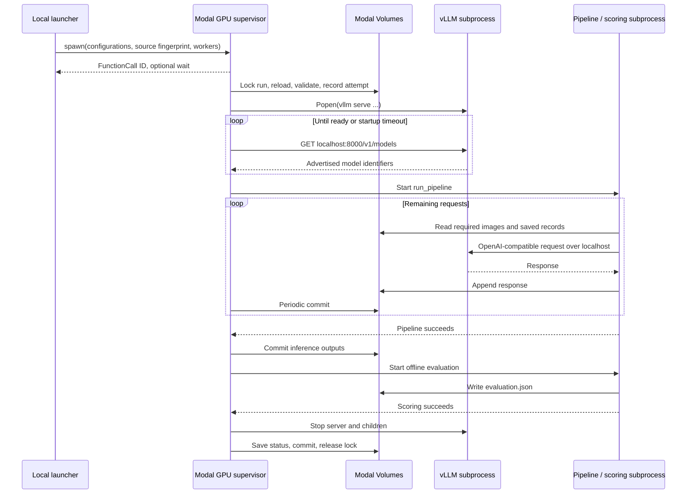
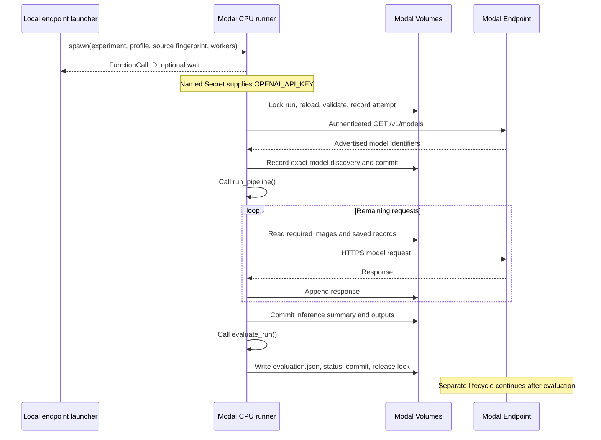

# Modal implementation guide

This document explains how the Modal integration packages and executes the
experiment, persists results, and handles failures. For configuration examples
and commands, use [Run the experiment on Modal](MODAL_README.md). The
[experiment README](README.md) remains authoritative for benchmark construction,
experiment options, and offline evaluation.

Both execution modes use the same benchmark pipeline and scoring code.

## Architecture

The local repository supplies a packaged source snapshot. A Modal App connects
remote Functions to container Images, resources, and persistent Volumes. An Image
is the software environment from which a running container is created. Inputs
and outputs live on Volumes rather than in that container's temporary filesystem.

| Responsibility | Implementation |
| --- | --- |
| Frozen benchmark, prompts, parsing, request identity, and scoring | Existing `protocol/`, `inference/`, `validation/`, and `evaluation/` packages |
| GPU resources and durable submission | [modal/app.py](modal/app.py) |
| vLLM and experiment process supervision | [modal/launcher.py](modal/launcher.py) |
| CPU endpoint submission and resources | [modal/endpoint_job.py](modal/endpoint_job.py), [modal/endpoint_app.py](modal/endpoint_app.py) |
| Endpoint validation, discovery, and direct pipeline execution | [modal/endpoint_config.py](modal/endpoint_config.py), [modal/endpoint_launcher.py](modal/endpoint_launcher.py) |
| GPU configuration, source allowlist, and offline checks | [modal/config.py](modal/config.py), [modal/check.py](modal/check.py) |
| Provenance, attempt history, file metadata checks, and response-tail recovery | [modal/runtime.py](modal/runtime.py) |
| Selected-file staging and interrupted-upload recovery | [modal/stage.py](modal/stage.py), [modal/stage_recovery.py](modal/stage_recovery.py) |
| Independent CPU checkpoint download | [modal/download_job.py](modal/download_job.py), [modal/download_app.py](modal/download_app.py), [modal/download_model.py](modal/download_model.py) |

The Modal wrappers manage infrastructure. They retain the existing prompt,
parser, retry, resume, and scoring contracts instead of introducing a second
experiment implementation.

| Property | With vLLM serving | Endpoint |
| --- | --- | --- |
| Evaluation container | GPU container with vLLM | Python 3.12 CPU container |
| Model service | Supervised vLLM subprocess in the evaluation container | Existing Shared or Dedicated Endpoint |
| Request route | `http://127.0.0.1:8000/v1` | Configured HTTPS API root ending in `/v1` |
| Model storage | Read-only checkpoint Volume | Managed by the separate endpoint |
| Pipeline and scoring | Supervised subprocesses | Direct `run_pipeline()` and `evaluate_run()` calls |
| Credentials | Launcher supplies the loopback placeholder | Named Secret injects `OPENAI_API_KEY` |
| Explicit periodic result commits | Configured `commit_interval` | None, uses background commits and execution boundaries |

Shared and Dedicated Endpoints use the same CPU runner. The differences supplied
to the runner are the URL, advertised model identifier, Secret, and optional
operator-recorded deployment identity. Endpoint internals are outside this
integration.

## Configuration and source packaging

Serving and experiment JSON files are read on the local machine. Parsed values,
resource settings, and the source fingerprint are passed to the remote Function.
The remote wrapper writes temporary configuration files for the existing
pipeline. Model settings do not require manual JSON uploads to a Volume.

Each launch requires an explicit `--profile PATH`, including checkpoint downloads.
Old profile-selection environment variables are ignored. The GPU launcher validates local arguments before importing its App, which reads
this argument while defining its resources. The endpoint launcher validates
all local job arguments before importing its App or the Modal SDK. Its `--check`
path computes the allowlisted source fingerprint without contacting Modal or
the endpoint. The GPU workflow provides a separate offline `modal.check` command
for standalone validation without submission.

GPU validation checks the loopback URL, served-model name agreement, checkpoint
path boundaries, managed vLLM argument conflicts, and tensor parallelism against
allocated GPUs. vLLM arguments are an ordered list passed to `Popen` without shell
interpretation. The wrapper owns the model path, served-model name, host, and
port.

Endpoint validation requires an HTTPS API root ending in `/v1`, rejects embedded
credentials, query strings, fragments, and unfilled placeholders, and validates
the CPU profile and benchmark path. Both modes retain the experiment's existing
schema. Remote readiness checks run at startup.

### Generation request options

`inference/experiment_config.py` accepts optional `reasoning_effort` and
`max_completion_tokens` fields. The latter must be a positive integer, excluding
booleans. Null options normalize to absence. Endpoint validation applies its
identifier checks to string fields and retains the validated integer cap.
Both Modal wrappers pass the normalized experiment through their temporary
configuration files to the shared pipeline.

`run_change_labels.execute_specs` carries the options through sequential and
concurrent submission. PAIR, SEQ, SEQ-DIR, REF-LC, PAIR-LC, and SEQ-LC all use
`model_client.build_chat_request`, which includes each option only when non-null.
Retries reuse the same request. There are no capability probes, aliases, or
fallback requests. Fixed-code composition needs no token limit.

The cap is recorded in `run_manifest.json` under `experiment` and in Modal
provenance. Preparation, preflight, standalone stage checks, and Modal provenance
comparisons reject changed limits before inference. Omitted and null limits are
equivalent, including for older saved runs. Prompt and model-input identities
remain unchanged, and adding, removing, or changing an explicit cap requires a
new run name. The response schema and benchmark versions remain unchanged.

The cap applies per attempt to generated tokens. Input and server context limits
remain separate. A non-empty response stopped by the cap receives the existing
parser treatment without retries. An empty answer remains a technical failure
with up to three attempts at the same cap. Sanitized errors retain the parameter
name `max_completion_tokens` when the server reports it.

### Source packaging

Each App defines the same Image and Volume dependencies during local and remote
imports. Validated non-secret profile values are embedded in the Image environment
so the container can reconstruct its resources without opening a laptop file.
Only copying local source is conditional on `modal.is_local()`. Defining
resources differently in the two environments can cause SDK dependency hydration
failures before the Function starts.

`source_files()` defines the runtime allowlist. `package_source()` copies those
files, including package initializers and the golden-prompt checksum fixture,
into `/app` with one filtered `add_local_dir(..., copy=True)` step after dependency
installation. The filter prunes unrelated directories before traversal, including
`data/`, `artifacts/`, `tmp/`, `.git/`, and `.venv/`. The same selection is hashed
for source identity. The endpoint Function also sets `include_source=False`
because its source is already present through that explicit copy.

The GPU Image inherits Python and vLLM from the selected registry image and
installs `openai==2.48.0` plus optional exact package pins from the profile. It
provides a `python` alias when the base image exposes only `python3`. The endpoint
Image is independent of vLLM and installs `openai==2.48.0` and `modal==1.5.5` on
Python 3.12. The downloader has a separate CPU Image with its pinned Hub client.
Local/container dependency consistency and the source-copy allowlist are covered
by regression tests.

## Storage and input preparation

Each resource name starts with the configured `volume_prefix`. Both runners
mount the benchmark root at its repository-relative location under `/app`, which
is also their working directory. Consequently, an experiment's `benchmark_path`
resolves unchanged inside the container. The staging tool removes the benchmark
root prefix only when choosing the path within the benchmark Volume.

| Volume suffix | Container mount | GPU runner | Endpoint runner |
| --- | --- | --- | --- |
| `-images` | `/data/images` | Read only | Read only |
| `-benchmarks` | `/app/artifacts/temporal_reasoning_single_finding/benchmarks` | Read only | Read only |
| `-models` | `/models` | Read only | Not mounted |
| `-results` | `/app/artifacts/temporal_reasoning_single_finding/runs` | Read/write | Read/write |

The endpoint App requires the images and benchmark Volumes to exist and creates
the results Volume if needed. A separate `<volume_prefix>-locks` Dict coordinates
writers. The CPU downloader mounts the model Volume read/write, while staging
recovery mounts the image Volume read-only.

### Staging transaction

Staging enumerates the frozen benchmark and its referenced unique PNGs, retaining
the directory structure expected by the runner. Source `.jpg` identifiers map
to runtime `.png` paths. Explicit staging computes streaming image checksums,
including when run only to report an inventory. It never emits image payloads.

Uploads occur in batches of at most 16 images. The uploader records the image
index after each completed batch, uploads the manifest and referenced benchmark
JSON files, and finally publishes `modal_images.json`. That completion record
binds the image inventory to the benchmark checksum. Matching indexed images
and matching frozen files are reused. Changed content at an existing path is
rejected. A new benchmark must be staged even when its images overlap a prior one.

An interrupted upload can leave files outside the saved index. Recovery checks
only those unindexed paths in a separate CPU Function on Modal and returns sizes
and SHA-256 hashes. It does not download image payloads to the laptop. Indexed
repeats skip that Function. Staging and recovery never run implicitly at normal
experiment startup.

### Checkpoint download transaction

The independent download App validates the GPU profile but uses only its Volume
prefix and optional region. It neither imports the inference App nor constructs
the vLLM Image. An optional named Secret containing `HF_TOKEN` is attached only
to the download Function. Model bytes travel directly from the provider to the
model Volume.

The downloader accepts an optional full 40-character revision SHA. When omitted
for a new, empty destination, the CPU worker resolves `main` using its existing
authentication and records the full SHA in `modal_download.json` before downloading
that exact revision. Resolution adds one small metadata request. When the
destination already has an identity, omission reuses the recorded SHA without
checking for updates. The repository and any explicitly supplied SHA must match.
Unmanaged nonempty destinations are rejected.

The download includes the selected snapshot's weights, tokenizer, configuration,
and processor files without filtering to only files used by vLLM. On completion,
the worker records file paths and sizes in `modal_checkpoint.json` and commits
the Volume. Compatible incomplete downloads resume at the same destination.
Compatible completed downloads are reused after metadata checks. A newer revision
requires a new destination, with its own download and storage cost.

Normal model reuse and experiment startup check completion records, file
existence, and sizes. They do not hash model weights or image contents. Older
markers with checksum fields remain supported without recomputing payload hashes.
Completed input directories must remain unchanged because metadata checks cannot
detect same-size edits. Small source, prompt, and benchmark fingerprints remain
part of identity validation.

## Submission and invocation lifetime

The GPU local entrypoint submits once with `.spawn()`, prints the FunctionCall ID,
and waits using `.get()`. The operator supplies `--detach` to retain the App when
the local client exits. The endpoint and checkpoint-download commands create
detached Apps themselves and also submit with `.spawn()`. Endpoint `--no-wait`
omits the local wait. These paths neither cancel nor resubmit a job when the local
wait is interrupted.

App lifetime and invocation lifetime are separate. A detached App alone does not
make a synchronous `.remote()` invocation durable. The implementation therefore
uses asynchronous submission as well as detachment. Timeouts and cloud-side
termination still apply. See Modal's [invocation durability](https://modal.com/docs/guide/function-invocation-methods#durability)
and [App lifetime](https://modal.com/docs/guide/apps#ephemeral-apps) documentation.

## vLLM execution lifecycle

The GPU Function locks the run name and reloads mounted Volumes before accessing
saved outputs. It validates the source against the current submission, verifies
staged input metadata, checks resume provenance, and records the attempt. It
repairs an interrupted response tail and commits these records before serving.



The supervisor rejects an occupied localhost port before starting vLLM and
requires discovery of the exact served-model identifier. It sets offline model
loading and a nonempty loopback `OPENAI_API_KEY` placeholder for this local
transport. The download credential is separate. Model weights load from `/models`
into GPU memory on each server startup.

The supervisor starts pipeline and scoring subprocesses sequentially, monitors
server liveness, forwards their stdout/stderr to Modal logs, and commits outputs
periodically during subprocess execution. It invokes scoring only after the
pipeline succeeds. On handled exit, it stops child process groups, escalating
from SIGTERM to SIGKILL when necessary.

The GPU remains allocated during input checks, benchmark preparation, inference,
and scoring. vLLM remains running until scoring finishes. `workers` controls
inference concurrency inside the job. It does not create additional Modal
containers. Subprocesses let the supervisor monitor pipeline progress and server
liveness while managing the independently running vLLM server.

## Endpoint execution lifecycle

The endpoint App allocates CPU and memory, mounts three Volumes, and injects the
named Secret with `required_keys=["OPENAI_API_KEY"]`. It preserves the injected
API key. Only the Secret name appears in the resource profile. Authentication
values do not belong in experiment configuration or explicit provenance records.

The Function locks the run and reloads its mounts. It verifies the submitted
source and staged benchmark/image metadata, checks provenance, records the
attempt, and repairs any interrupted response tail. It then authenticates
`/v1/models` discovery before entering the existing pipeline.



The Modal Endpoint is a black box in this integration. The runner owns no server
process, so it can call `run_pipeline()` and `evaluate_run()` directly. No vLLM
installation, model Volume, GPU allocation, or `subprocess.Popen` is needed.
Both modes execute the same preflight, preparation, ordered inference,
deterministic derivation, coverage validation, and offline scoring.

Readiness requests use the remaining `startup_timeout` budget, a per-request
limit of at most ten seconds, and no SDK retries. Connection failures, HTTP 408,
429, and 5xx responses can be polled again within that budget. Permanent HTTP
failures, malformed model metadata, or a missing exact model identifier fail
readiness. Readiness errors use the same sanitized diagnostics as fatal inference errors.

Successful discovery writes `endpoint.json` under the attempt directory with
configured and discovered identifiers and `weights_verified: false`. Use the
optional `deployment_identity` fields to record the deployment or checkpoint
revision. These fields become part of resume identity.

## Persistence and recovery

Both runners keep the canonical run under `runs/<run_name>/` and infrastructure
metadata under `runs/.modal/<run_name>/`. The metadata directory is separate so
it does not interfere with pipeline preparation. Original `provenance.json`
remains immutable. Each accepted attempt adds
`attempts/<attempt_id>/provenance.json` with a UTC start time and full provenance,
plus its own `status.json`. The top-level status records the latest handled
outcome. Legacy runs gain attempt history from their next accepted invocation.
Historical attempts are not reconstructed.

Worker counts, source fingerprints, resource profiles, and installed package
versions may change between attempts. Each container must still match its
current submission. Both modes require compatible experiment values and
benchmark identity, plus prompts, prepared inputs, and saved responses. The GPU
path compares model/generation serving configuration, server command, and checkpoint
inventory, excluding the six mutable execution options listed in the
[resume requirements](MODAL_README.md#resume-requirements). Each attempt still
records the complete, unfiltered configuration. The endpoint path compares
execution mode and any supplied deployment
identity, so an existing localhost run cannot resume through the endpoint runner
under the same name.

An existing run without Modal provenance is adopted only after validating its
saved experiment, benchmark, prepared checksums, and initial prompts. Its first
Modal identity is recorded separately from an `import.json` containing the
imported manifest checksums. Historical PC serving settings are not inferred.
For migrations with available source Modal provenance, adoption also checks
that identity under the original run name and records the source path and hash.
Original run files and source history remain unchanged. Saved response validation
and reuse continue through the normal pipeline, including for partial runs.

Historical `enable_short_explanation: true` normalizes to the permanent prompt
behavior. Supported old prompt fixtures retain the same model-input IDs. A saved
`false` mode supports offline scoring but cannot resume inference with the current
prompts. Unknown fixture revisions remain rejected. Code compatibility alone does
not prove that a bug left prior outputs correct. The integration does not
implicitly invalidate, reparse, or resubmit completed responses after a code fix.

Changing the Volume prefix changes the input/result Volumes and lock Dict.
There is no automatic transfer or search for previous runs. Required inputs,
the canonical run, and its separate metadata must be made available explicitly
at the same paths, after the original writer stops. An empty destination starts
a new run and repeats inference. Changing GPU or serving software can affect
outputs even when request and checkpoint identities remain compatible.

A local file flush or `fsync` is distinct from a Volume commit. Both modes use
Modal background commits. The GPU supervisor additionally commits at its configured
interval and subprocess boundaries. The endpoint wrapper explicitly commits
initial metadata/recovery, successful discovery, completed inference, and final
scoring/status. It has no custom periodic commit thread or `commit_interval`.
Other running containers may need to reload to see committed files. See
[Volume commits and reloads](https://modal.com/docs/guide/volumes#volume-commits-and-reloads).

Response-tail recovery backs up an unterminated final JSONL record before repair.
It preserves complete records, adds a newline to an otherwise complete final
record, or removes an incomplete final record. Earlier complete-line corruption
is rejected rather than silently repaired. Valid, invalid, and exhausted
technical-error records are all completed records for resume purposes. Missing
or uncommitted responses can be requested again. Neither background commits nor
tail repair guarantees exactly-once submission or billing.

Run locks use `run:<run_name>` in `<volume_prefix>-locks`. Handled completion
releases the lock. Each lock stores its owning FunctionCall ID. After worker
loss, an automatic restart with the same FunctionCall ID can reuse that lock
without operator removal. A new submission has a different call ID and cannot
take over the existing lock automatically.

Abrupt termination can leave a stale lock and persisted `running` status. That
status is not a liveness probe. If a new submission is blocked by a leftover
lock, confirm that its owning FunctionCall has stopped before removing only its
individual key, with other launchers stopped. Never remove an active writer's
lock or clear the whole Dict.
The [usage guide](MODAL_README.md#resume-requirements) describes recovery steps.

## Failure handling and cancellation

The shared inference scheduler cancels queued futures on controller interruption
before waiting for active requests. It saves their completed responses while the
writer is usable, then rethrows the original failure. A failed or interrupted
append stops further writes so resume can repair the tail. Active calls may finish
or time out before cleanup completes. Worker request failures retain the existing
bounded retry policy. Cancellation does not introduce new retries or mask the
original error.

The endpoint wrapper attempts to save failed status and commit partial results
on handled failure. Failure to persist or release the lock adds a note without
replacing the original exception. Required success-path commit failures propagate.
The GPU supervisor attempts process shutdown and final persistence on handled
exit. Earlier validation failures and hard termination can prevent status writes,
commits, or lock release. Cleanup is best effort under those conditions.

**API exception sanitization:** discovery and fatal inference SDK errors become
`EndpointRequestError` before leaving the transport. Retry classification uses
the original SDK error first. Fatal errors still fail the invocation, and
exhausted retryable errors retain the existing saved-response schema.

The replacement retains the SDK error category, HTTP status, filtered request ID,
operation, endpoint host, configured model, recognized error code and parameter,
and a locally generated diagnostic. It also records stack locations without
frame locals or source text. Worker failures include the benchmark model-input
checksum when available. Unknown server messages are explicitly omitted, so use
the request ID to locate detailed endpoint logs when the summary is insufficient.

Raw messages, request/response bodies, headers, cookies, and the original HTTP
objects are not attached. Metadata is bounded and filtered for known credentials,
including the two parts of a Modal proxy token. The replacement is raised outside
the SDK exception handler, with no original cause or context.

## Data movement and resource costs

The laptop uploads selected images once during explicit staging. With vLLM,
repeated encoded image requests stay on localhost inside the GPU container.
Endpoint requests travel from the mounted image Volume through the CPU container
to the external endpoint over HTTPS. Moving the runner to Modal avoids repeated
laptop uploads but does not eliminate endpoint network traffic or its costs.

Normal startup reads input metadata and small benchmark/source fingerprints.
It does not hash model weights or radiographs. Explicit staging still hashes
selected local images. Interrupted-upload recovery reads unindexed remote images
inside a separate CPU job. Checkpoint download transfers the selected snapshot.
These operations are separate from ordinary evaluation startup.

GPU mode pays for the GPU throughout startup, preparation, inference, and scoring.
Endpoint mode pays for CPU execution separately from endpoint inference and
applicable transfer. The endpoint has an independent lifetime, so completing the
CPU job does not stop it. Compute-region selection alone does not establish
Volume residency or endpoint routing.

Inference retains the existing maximum of three attempts for retryable failures
with SDK-level retries disabled. Modal Function retries are disabled. Response
recovery and offline scoring read saved text records.

## Tests

Run the adapter tests from the repository root:

```shell
uv run --group modal python -m unittest discover \
  -s experiments/temporal_reasoning_single_finding/tests -t . -v
```

The tests cover configuration, source packaging, submission, persistence,
recovery, and failure handling. See the [run guide](README.md#tests) for the
complete verification commands.
